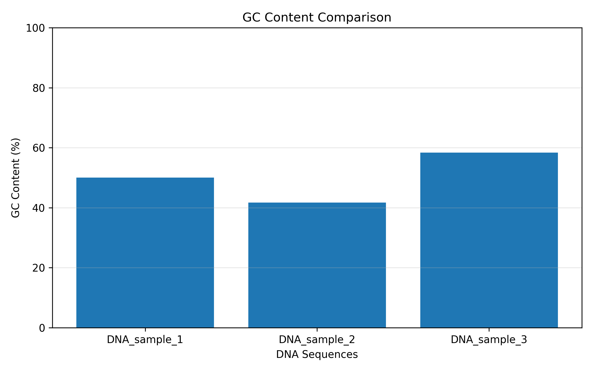

# DNA Sequence Analyzer

## Project Overview

DNA Sequence Analyzer is a Python-based bioinformatics project designed to perform basic DNA sequence analysis.

The project demonstrates the application of programming and data analysis techniques to biological sequences.

## Features

- Read DNA sequences from FASTA files
- Validate DNA sequences
- Calculate sequence length
- Count A, T, G, and C nucleotides
- Calculate GC content percentage
- Visualize nucleotide distribution
- Compare two DNA sequences of equal length
- Detect nucleotide substitutions

## Technologies Used

- Python
- Matplotlib
- Requests
- Pytest
- GitHub
- Google Colab

## Project Structure

- dna_analyzer.py: Main Python program
- sample.fasta: Example DNA sequence
- test_dna_analyzer.py: Validation tests
- README.md: Project documentation

## Testing

The project includes four automated tests using Pytest.

All four DNA validation tests passed successfully.

## Future Improvements

- Support multiple FASTA sequences
- Analyze real biological datasets
- Improve sequence comparison
- Add a graphical user interface

## Project Status

Version 1.0 - Educational prototype.

Developed as a personal bioinformatics learning project.
## Version 2.0 — Multiple DNA Sequence Analysis

The second version of DNA Sequence Analyzer extends the original Python bioinformatics project with automated analysis of multiple DNA sequences.

### New Features

- Read and process multiple DNA sequences from FASTA files.
- Validate nucleotide sequences before analysis.
- Calculate sequence length and nucleotide composition (A, T, G, C).
- Calculate GC content for each DNA sequence.
- Generate comparative analysis tables using Pandas.
- Export analysis results to CSV format.
- Generate and save GC content comparison charts using Matplotlib.

### GC Content Visualization

The following chart compares the GC content of three example DNA sequences.

### Example Results

| Sequence | Length | GC Content (%) |
|---|---:|---:|
| DNA_sample_1 | 12 | 50.00 |
| DNA_sample_2 | 12 | 41.67 |
| DNA_sample_3 | 12 | 58.33 |

### Automated Testing

The project includes seven automated tests using Pytest.

All seven tests passed successfully, covering DNA validation, FASTA parsing, and multiple-sequence analysis.

### Project Status

**Version 2.0 — Educational bioinformatics prototype.**

This project demonstrates practical skills in Python programming, biological sequence analysis, data visualization, and automated software testing.
